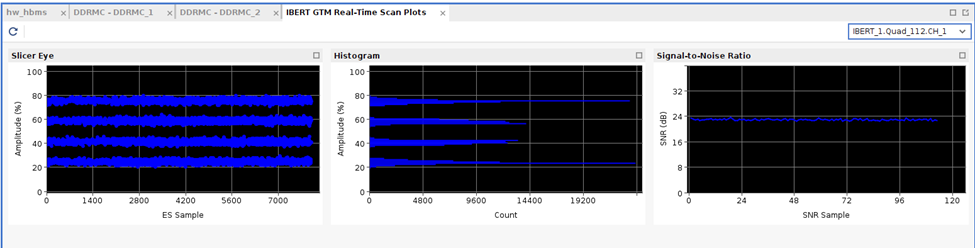

# Versal DCMAC at 200 Gb/s

Reusable Vivado block design for the AMD DCMAC on Versal. Ships the HDL,
the TCL build script, and a standalone BD project so you can pull DCMAC into
a Versal design without rebuilding it from scratch.

DISCLAIMER: While tested and functional, this repository is still a work in progress and may need minor changes to fit other projects.

## Scope

Targets the V80 in 200GAUI-4 mode with RS(544) FEC. A single DCMAC instance
drives one QSFP56 cage; the package supports two instances on the same device
(`DCMAC_X1Y1` and `DCMAC_X0Y2`) and an optional dual-QSFP56 mode that uses
both GT quads of one DCMAC.

Single-DCMAC is the tested configuration.
**Dual-QSFP modes are experimental and have not been hardware-validated**, treat them as work-in-progress.

## Repository organization

| Path | Purpose |
|---|---|
| `tcl/dcmac.tcl` | Main block design script. Exports `bd_dcmac` and `bd_dcmac_qsfp`. |
| `tcl/board_config.tcl` | Per-board DCMAC site dict, keyed on `(board, dcmac_index)`. |
| `hdl/` | Reset FSM, segment converters, control-port helpers, clock fan-outs. See `hdl/README.md`. |
| `example/` | Standalone BD project: `Makefile` + `create_dcmac_example.tcl`. |

## Requirements

- Vivado **2025.1** or newer

## Integrate in your design

`tcl/dcmac.tcl` exports two TCL procs (`bd_dcmac` and `bd_dcmac_qsfp`) that
build the DCMAC hierarchy in a Vivado block design. See
[example/](./example/) for parameters, usage, and how to call them from
your own project.

## External projects

Used by:

- [Coyote](https://github.com/fpgasystems/Coyote) — ETH Zurich's FPGA shell
  for cloud/data-center workloads.
- [SLASH](https://github.com/Xilinx/SLASH) — AMD's Versal accelerator
  framework.

## Hardware notes

- GT reference clock: 322.265625 MHz.
- DCMAC core clock: 782 MHz; AXIS clock: 391 MHz nominal (`nclk_f`).
- 200GAUI-4, RS(544) FEC.
- Each DCMAC site supports an optional second QSFP56 via the second GT quad.

## GT control for DCMAC Operation

### Resets

Reset process is controlled by the HDL module [dcmac_reset_ctrl_wrapper.v](hdl/dcmac_reset_ctrl_wrapper.v).

### Free-running clock for reconfigurable regions

The reset FSM and the GT `gtwiz_freerun_clk` need a stable `sys_clk`. By default
it is derived from the GT reference clock, which disappears during
reconfiguration of a reconfigurable region.

For reconfigurable regions use the wrapped-QSFP flow (`bd_dcmac_qsfp`), which
exposes an external `freerunning_clk` input. This clock must be **100 MHz**,
sourced from outside the reconfigurable region and stable during reconfiguration.
It drives `sys_clk` and, when `dcmac_axil=1`, it drives the AXI4-Lite path.
The flat `bd_dcmac` flow keeps the GT-derived `sys_clk` and routes the
AXI4-Lite path through `aclk`.

### Set swing and pre/post-emphasis

To be able to transmit, we need to set the corresponding `CH*_TXMAINCURSOR`, `CH*_TXPRECURSOR` and `CH*_TXPOSTCURSOR`. In general these parameters will depend on the board path from the transceiver pins to the QSFP cases.

* TXMAINCURSOR: Sets the voltage swing. For the v80 ports brought up so far, the value **52** was found to give good BER.
* TXPRECURSOR: Sets pre-emphasis. For the v80 ports brought up so far, the value **6** was found to give good BER.
* TXPOSTCURSOR: Sets post emphasis. For the v80 ports brought up so far, the value **6** was found to give good BER.

Notes:
* Take into account that for many DCMAC settings PAM4 is used, not NRZ binary signaling. Therefore, pre/post-emphasis needs to be set more carefully, as information is not only encoded in the polarity, but also the signal amplitude.
* We are dealing with analog circuits, actual driver output voltages will vary from chip to chip due to manufacture variability.
* There are 2 additional pre-emphasis drivers, for times -2 and-3, but these were not needed to get an stable link.  

For more info on Pre/post-emphasis, see section Pre-Emphasis of [this book](https://www.xilinx.com/publications/archives/books/serialio.pdf). 
[Docs](https://docs.amd.com/r/en-US/am017-versal-gtm-transceivers/TX-Configurable-Driver)

## DCMAC Documentation
* Clocks: Check [Clocking section](https://docs.amd.com/r/en-US/pg369-dcmac/Clocking)
  * To know the clocks configurations required for a specific DCMAC channel setting check [Clocking Relationships section](https://docs.amd.com/r/en-US/pg369-dcmac/Clocking-Relationships)
* Resets:
  * [Resets description](https://docs.amd.com/r/en-US/pg369-dcmac/Resets)
* Operational Guidelines
  * [Transmit Fixed Ethernet Startup Procedure without reconfiguration](https://docs.amd.com/r/en-US/pg369-dcmac/Transmit-Fixed-Ethernet-Startup-Procedure-when-Using-tx_core_reset)
  * [Receive Fixed Ethernet Startup Procedure without reconfiguration](https://docs.amd.com/r/en-US/pg369-dcmac/Receive-Fixed-Ethernet-Startup-Procedure-when-Using-rx_core_reset)
* [Statistics Monitoring] (https://docs.amd.com/r/en-US/pg369-dcmac/Statistics-Monitoring)
* Register Map: [Download excel with register map spec](https://docs.amd.com/viewer/book-attachment/79NY3iPGqwGWicjQjhDCRQ/V~R8bj2ZvfFnn4Kg7Syoiw-79NY3iPGqwGWicjQjhDCRQ)

## Debug

### GT Loopbacks

Consider using the GTM provided loopbacks to decouple problems. See docs [here](https://docs.amd.com/r/en-US/am017-versal-gtm-transceivers/Ports-and-Attributes?tocId=VCPR5g15KRqYyFFYnjyWoQ)

### IBERT

Allows detecting signal quality issues. Here we can see a snapshot of a working link using PAM4 modulation:

* ES Sample shows analog values at their sample point (we do not see the actual eye diagram)
* We can also see a histogram of the ES samples (it can be reset with the circular arrow in the top left corner)
* SNR: We observed that ~24 SNR provides good link stability.

Accessing these plots from the hardware manager should allow you to detect problems in the physical layer.

## License

MIT Licence

- Copyright (c) 2026, Systems Group, ETH Zurich
- Copyright (C) 2025 Advanced Micro Devices

## Acknowledgments  

This work was supported in part by AMD under the [Heterogeneous Accelerated Compute Clusters (HACC) program](https://www.amd-haccs.io/).
